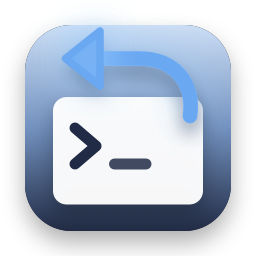
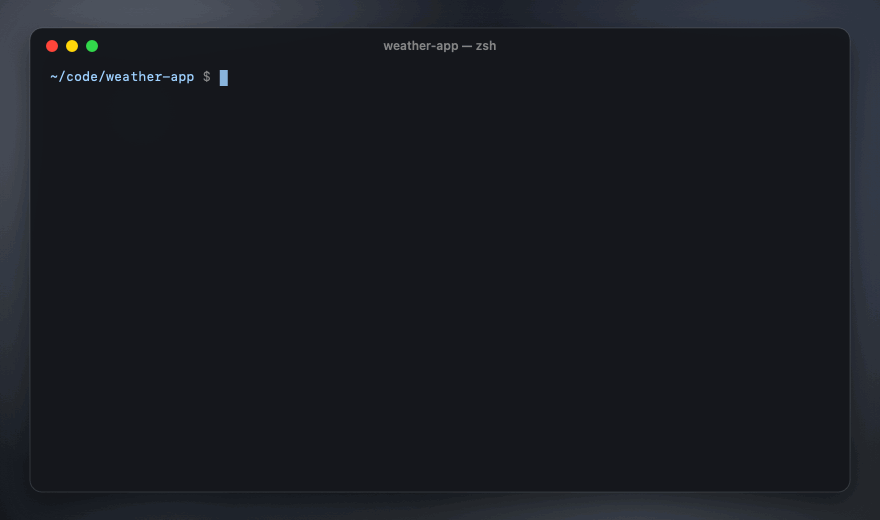

<p align="center">
  
</p>

<h1 align="center">mulligan</h1>

<p align="center">
  <b>Undo for coding agents.</b><br>
  A small, free, open-source command line tool that snapshots your project every time your agent gets a prompt or is about to use a tool, so you can list what happened, see the diff and put your files back to any point. Works with Codex, Claude Code, Gemini CLI, OpenCode, Cursor, Copilot CLI, Aider and anything else, and catches changes made by shell commands too.
</p>

<p align="center">
  <a href="#install"><b>Install</b></a>
  &nbsp;·&nbsp;
  <a href="https://stanczykwyatt.github.io/mulligan/">Website</a>
  &nbsp;·&nbsp;
  <a href="https://github.com/users/stanczykwyatt/projects/1">Roadmap</a>
  &nbsp;·&nbsp;
  <a href="https://github.com/stanczykwyatt/mulligan/discussions">Discussions</a>
</p>

<p align="center">
  <a href="https://github.com/stanczykwyatt/mulligan/actions/workflows/ci.yml"></a>
  <a href="https://github.com/stanczykwyatt/mulligan/releases/latest"></a>
  
  
  
  <a href="LICENSE"></a>
</p>

<p align="center">
  
</p>

---

You ask the agent for one thing. It does that, then runs a formatter over half the project and deletes a folder it decided was unused. Its own undo, if it has one, only knows about the edits it made itself, not what its shell commands did.

In golf, a mulligan is a free do-over, and that's what this gives you. It keeps a timeline of your files. Every prompt, every tool call and every end of a turn gets a snapshot, taken from the files themselves, so it doesn't matter whether the agent changed them with its edit tool, a shell command, a code generator or a formatter. `mulligan list` shows the timeline, `mulligan diff 2` shows what changed since a point, and `mulligan undo 2` puts everything back. Undo itself is undoable.

Snapshots are kept in a separate git repository outside your project, so your own repository, its history, index, stash and hooks are never touched. There's nothing to run in the background and nothing goes online.

If it saves you from a bad agent run, [starring the repo](https://github.com/stanczykwyatt/mulligan/stargazers) helps other people find it.

## Features

- **Agent-agnostic.** Hooks for Codex, Claude Code, Gemini CLI, OpenCode, Cursor, Copilot CLI, Qwen Code and Pi, and `mulligan run -- <agent>` for anything without hooks, like Aider.
- **Catches shell changes.** Snapshots are of your files, not of the agent's edits, so `rm -rf`, `sed -i`, formatters and generators are all covered.
- **A real timeline.** See every snapshot with what changed after it, diff any two points, and go back to any of them.
- **Undo and redo.** `undo` steps back, `undo 4` jumps to a point, `redo` takes it back. Every restore snapshots your files first.
- **Restore just one file or folder** from any point, leaving the rest alone.
- **Never touches your repository.** No commits, branches, stashes or index changes. Works in folders without git too.
- **Careful with your files.** It never deletes or overwrites anything it couldn't put back. Ignored files, huge files and nested repositories are left alone.
- **Tiny and private.** One small binary, git as its only requirement, no network access, no telemetry. Free and MIT-licensed.

## Install

macOS 13 or later, or Linux on x86_64 or ARM64, with git 2.25 or later.

```bash
mkdir -p ~/.local/bin && curl -fsSL "https://github.com/stanczykwyatt/mulligan/releases/latest/download/mulligan-$(uname -s)-$(uname -m).tar.gz" | tar -xz -C ~/.local/bin mulligan
```

That downloads the binary for your system from the [latest release](https://github.com/stanczykwyatt/mulligan/releases/latest) into `~/.local/bin`. If `mulligan --version` isn't found afterwards, add `~/.local/bin` to your PATH. Each download has a `.sha256` file beside it, if you'd like to check it first. The Linux binaries are fully static, so they run on any distribution.

### Build from source

You need Swift 6.1 or later: it comes with Xcode 16 or the Command Line Tools on a Mac, and from [swift.org](https://www.swift.org/install/) on Linux.

```bash
git clone https://github.com/stanczykwyatt/mulligan.git
cd mulligan
swift build -c release
cp .build/release/mulligan ~/.local/bin/
```

## Set up your agent

`mulligan setup <agent>` prints exactly what to add to your agent's config, and where. mulligan never edits those files itself.

| Agent | How | Snapshots |
|---|---|---|
| Codex CLI 0.124+ | hooks in `~/.codex/hooks.json`, then trust them in `/hooks` | each prompt, before each tool, each turn's end |
| Claude Code | hooks in `~/.claude/settings.json` | each prompt, before each edit or command, each turn's end |
| Gemini CLI 0.27+ | hooks in `~/.gemini/settings.json` | each prompt, before each edit or command, each turn's end |
| OpenCode 1.x | a small plugin in `.opencode/plugins/` | each message, before each tool, when idle |
| Cursor's agent | hooks in `~/.cursor/hooks.json` | each prompt, after each edit and command |
| Copilot CLI | hooks in `~/.copilot/hooks/` | each prompt, before each tool, each turn's end |
| Qwen Code, Pi | hooks or an extension | each prompt, before each tool |
| Aider, or anything | `mulligan run -- aider` | whenever files change while it runs |

For Codex, for example, `mulligan setup codex` prints:

```json
{
  "hooks": {
    "UserPromptSubmit": [{ "hooks": [{ "type": "command", "command": "mulligan hook codex", "timeout": 30 }] }],
    "PreToolUse": [{ "matcher": "*", "hooks": [{ "type": "command", "command": "mulligan hook codex", "timeout": 30 }] }],
    "Stop": [{ "hooks": [{ "type": "command", "command": "mulligan hook codex", "timeout": 30 }] }]
  }
}
```

The hook prints nothing and always exits 0, so it can never block your agent or end up in its context. A snapshot with nothing new in it isn't kept, so the timeline only grows when files change.

## How to use it

| To | Run |
|---|---|
| See the timeline | `mulligan list` (`--all` for every snapshot) |
| See what changed since a snapshot | `mulligan diff 3`, or `mulligan diff 3 5` between two, `--stat` for a summary |
| Go back one step | `mulligan undo` |
| Go back to a snapshot | `mulligan undo 3` |
| Take the undo back | `mulligan redo` |
| Put one file or folder back | `mulligan restore 3 -- src/app.ts` |
| Take a snapshot by hand | `mulligan snap -m "before the big refactor"` |
| Run an agent without hooks | `mulligan run -- aider` |
| Snapshot while files change | `mulligan watch` in another terminal |
| See where snapshots are kept | `mulligan status` |
| Drop old snapshots now | `mulligan prune --keep 50` |
| Delete every snapshot of a project | `mulligan clear` |

Each snapshot in the timeline is a point just before something happened: a prompt, a tool call, or the end of a turn. Next to it is what changed after it, so `undo 3` takes back everything from that point on.

```
weather-app · 4 snapshots · ~/code/weather-app

  #1  6 min ago  codex  prompt: “add a 7-day forecast, and tidy up”   +1 ~1
  #2  5 min ago  codex  before Bash: npm run format                   ~23
  #3  4 min ago  codex  before Bash: rm -rf src/legacy                -6
  #4  3 min ago  codex  end of turn
```

mulligan works in the git repository you're in, from any folder inside it. For a folder without git, run `mulligan init` there once.

## How it works

Each project gets its own git repository in `~/.local/share/mulligan/projects/`, with your project as its work tree. A snapshot is a commit in that repository holding every file git would see: your `.gitignore`, your global git ignore file and `.git/info/exclude` all apply. Files are stored byte for byte, with no line-ending changes or filters. Unchanged files cost nothing extra, since git stores each version of a file once.

Undo takes a snapshot of your files as they are, then moves them from that snapshot to the one you picked with git's two-tree update, which only replaces or removes files whose contents are in one of the two. So anything it changes, it can change back. Anything on disk that the first snapshot couldn't hold, like an ignored file, a file over the size limit or a nested repository, is left exactly where it is, and mulligan tells you so.

## Safety and privacy

mulligan rewrites files in your project, so it's built to fail safe:

- **Your repository is never touched.** Every git command it runs points at its own repository. Your `.git`, history, index, stash, config and hooks are never read or written, apart from reading `.git/info/exclude`. Your git config isn't read either, so nothing in it can run.
- **Nothing is lost.** Every undo, redo and restore takes a snapshot first. If that snapshot fails, say on a full disk, nothing is changed. A file is only replaced or removed if the snapshot holds it.
- **It won't run at the top of your disk.** It refuses your home folder, `/` and system folders, and a project that would hold its own snapshots.
- **Concurrent hooks are safe.** One lock per project means snapshots taken at the same moment happen one after the other.
- **Big and odd files are skipped.** Files over 10 MB, sockets and pipes, and nested repositories and submodules are left out of snapshots, and left alone by restores.
- **Local only.** No network access, no telemetry, no account. Snapshots stay in a folder only you can read, and are capped at 500 per project, 30 days and 2 GB, all adjustable.
- **Prompts stay local.** The first words of a prompt label its snapshot in the timeline. Set `prompts = off` to keep them out.

[SECURITY.md](SECURITY.md) has the details.

## Settings

Put any of these in `~/.local/share/mulligan/config`, one per line, or set the environment variable:

| Setting | Variable | Default |
|---|---|---|
| `max-file-mb = 10` | `MULLIGAN_MAX_FILE_MB` | Files over 10 MB are left out |
| `keep = 500` | `MULLIGAN_KEEP` | Snapshots kept per project |
| `max-age-days = 30` | `MULLIGAN_MAX_AGE_DAYS` | Older snapshots are dropped |
| `max-store-mb = 2000` | `MULLIGAN_MAX_STORE_MB` | Space per project before the oldest go |
| `prompts = on` | `MULLIGAN_PROMPTS` | Label snapshots with a prompt's first words |
| | `MULLIGAN_HOME` | Where snapshots live, instead of `~/.local/share/mulligan` |
| | `MULLIGAN_DISABLE=1` | Makes hooks do nothing, for one session |

## FAQ

**How do I undo what Codex did?**
Set up the Codex hooks with `mulligan setup codex`, then after a turn run `mulligan list` and `mulligan undo` with the snapshot you want to go back to. Codex removed its own `/undo` in 0.128, and mulligan works alongside any version with hooks (0.124 or later), or through `mulligan run -- codex` on older ones.

**Claude Code and Gemini CLI already have checkpoints. Why use this?**
Their checkpoints track the agent's own file edits. Claude Code's docs say files changed only by Bash commands aren't tracked, and Gemini's rewind doesn't undo changes made through the shell tool. mulligan snapshots the files themselves, so those are covered, and one timeline works the same way across every agent you use.

**Does it mess with my git repository?**
No. It never commits, stages, stashes or checks out anything in your repository, and never changes its `.git`. Snapshots live in a separate repository in mulligan's own folder. You can run it with uncommitted work, a dirty index or in the middle of a rebase.

**What about files in .gitignore, like node_modules or .env?**
They're not snapshotted, and an undo never touches them. That keeps snapshots small, and secrets in ignored files out of them.

**How much space does it take?**
Usually very little: each snapshot only stores the files that changed, compressed. Files over 10 MB are left out, and each project's snapshots are capped at 2 GB and 30 days by default. `mulligan status` shows the size.

**Does it slow my agent down?**
Hardly. A snapshot is git checking file timestamps and storing only what changed: on a Mac, about a tenth of a second for a project of 5,000 files. The very first one stores everything, so it takes a few seconds on a big project. If another snapshot of the same project is still running, a hook waits at most 10 seconds, then lets your agent carry on.

**Does it work on Windows?**
Not yet. It runs on macOS and Linux. The Linux binary should work in WSL too, though that hasn't been tried yet.

## More free tools

- **[symbolhop](https://github.com/stanczykwyatt/symbolhop):** go-to-definition and find-references for coding agents, from your language servers.
- **[Show Desktop](https://github.com/stanczykwyatt/show-desktop):** hide every window with one click or ⌃⇧D, then bring them all back exactly as they were.
- **[Copy 2FA](https://github.com/stanczykwyatt/copy-2fa):** copy 2FA codes from Mail, Messages or a built-in authenticator with one keyboard shortcut.
- **[Who Stole My Focus](https://github.com/stanczykwyatt/who-stole-my-focus):** find out which app keeps jumping in front of your work.

None of them has internet access.

## Contributing

Contributions are welcome, especially hooks for more agents and reports of anything an undo got wrong. See [CONTRIBUTING.md](CONTRIBUTING.md), and the [roadmap](https://github.com/users/stanczykwyatt/projects/1) for what's planned. Ideas go in [Discussions](https://github.com/stanczykwyatt/mulligan/discussions).

## License

mulligan is released under the [MIT License](LICENSE) and is provided as is, without warranty of any kind. Keep backups and commit your work: mulligan is a safety net, not a backup.

mulligan is an independent project. It isn't affiliated with, endorsed by or sponsored by OpenAI, Google, Anthropic, GitHub, Microsoft, Anysphere, Alibaba or the makers of any agent it works with. Codex and OpenAI are trademarks of OpenAI. Gemini and Google are trademarks of Google LLC. Claude, Claude Code and Anthropic are trademarks of Anthropic, PBC. GitHub and Copilot are trademarks of GitHub, Inc. Cursor is a trademark of Anysphere, Inc. Git is a trademark of the Software Freedom Conservancy. Apple and macOS are trademarks of Apple Inc. Linux is a registered trademark of Linus Torvalds. Other names belong to their owners and are used only to say what mulligan works with. The project, files and session in the demo are made up.
